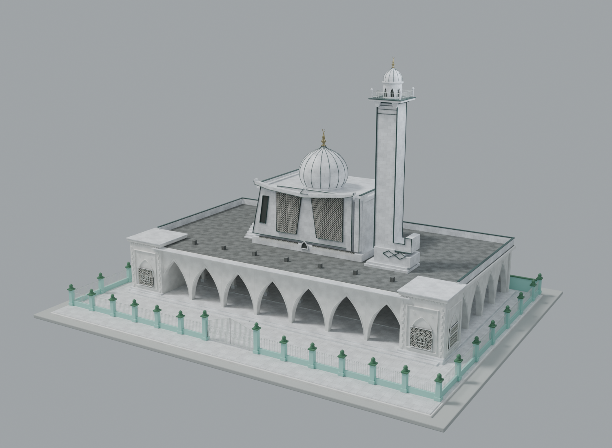
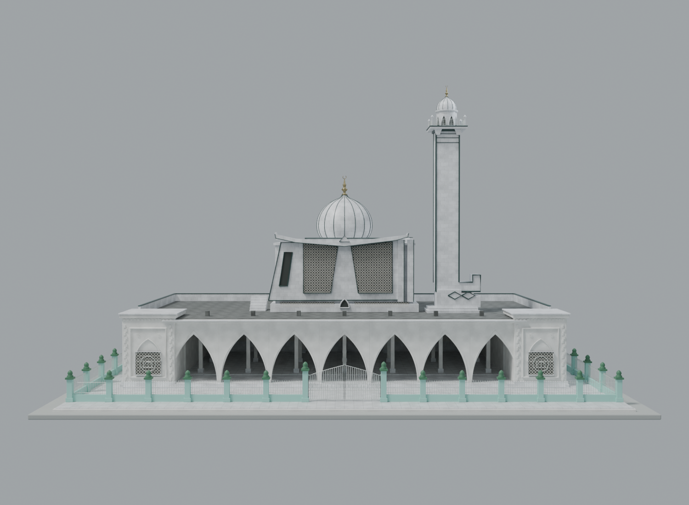
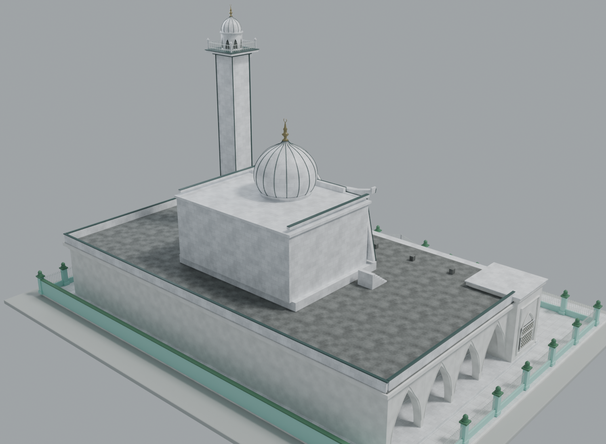
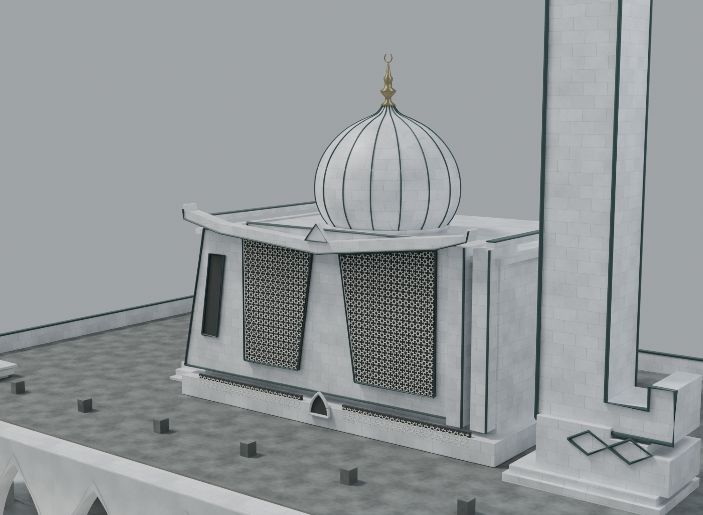
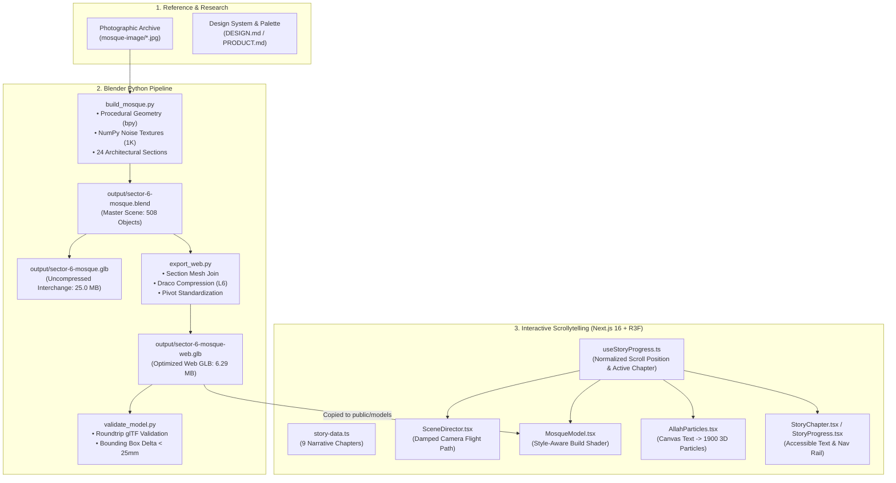

# 🕌 Sector 6 Mosque, Bhilai — 3D Procedural Reconstruction & Cinematic Scrollytelling

[](https://nextjs.org/)
[](https://docs.pmnd.rs/react-three-fiber)
[](https://threejs.org/)
[](https://www.blender.org/)
[](https://google.github.io/draco/)
[](https://www.typescriptlang.org/)
[](https://playwright.dev/)

An architectural digital archive, procedural 3D reconstruction, and interactive scrollytelling web experience of the iconic **Sector 6 Mosque in Bhilai, Chhattisgarh, India**.

This project pairs a reference-based procedural 3D modeling pipeline in Blender with a high-performance scrollytelling web application built in Next.js 16 and React Three Fiber, featuring custom GLSL reveal shaders, dynamic Arabic calligraphy particle morphing, and accessible responsive web design.

---

## 🌟 Key Highlights

- **Procedural Blender Architecture (`scripts/build_mosque.py`)**: Fully scripted 3D reconstruction generating 24 distinct architectural sections, 508 meshes, 180,000+ vertices, and 290,000+ triangles from metric coordinates and photographic references.
- **Synthesized Procedural Materials & Normals**: Tileable marble cladding, veined courtyard marble, lime plaster, and weathered terrace concrete generated via multi-octave NumPy value noise with central-difference gradient normal maps.
- **Web-Optimized Draco Pipeline (`scripts/export_web.py`)**: Sections batched and compressed from uncompressed master interchange (25 MB) down to 6.29 MB using `KHR_draco_mesh_compression`, preserving individual section hierarchies and build orders.
- **Style-Aware Build Choreography (`MosqueModel.tsx`)**: Custom vertex/fragment GLSL injected into Three.js `MeshStandardMaterial` (`onBeforeCompile`), assembling each section in the style its craft demands as the user scrolls — masonry laid *brick by brick*, ornament *drawn in light* as an architectural visualisation, and domes, finials & the minaret *emerging in one piece* from their own base.
- **Dynamic Calligraphy Particle Morphing (`AllahParticles.tsx`)**: 1,900 glowing additive particles that morph from ambient spatial dust into the traditional Arabic calligraphy for *"Allah"* (الله) and smoothly dissolve as architecture emerges.
- **Cinematic Scrollytelling (`SceneDirector.tsx`)**: 9 curated narrative chapters with smooth Hermite camera interpolation across keyframes tailored independently for desktop and mobile viewports.
- **Accessibility & Graceful Degradation (WCAG 2.2 AA)**: Native support for `prefers-reduced-motion` (replaces camera flight with static architectural viewpoints and crossfades) and automated WebGL fallback rendering.

---

## 🏛️ Gallery & Architectural Views

| Three-Quarter Elevation | Frontal Arcade Elevation |
| :---: | :---: |
|  |  |

| Rear Elevation & Courtyard | Jali Lattice & Minaret Detail |
| :---: | :---: |
|  |  |

---

## 📐 Project Architecture & Pipeline



---

## 🗂️ Repository Structure

```
blander-mosque/
├── DESIGN.md                          # Design system: OKLCH color palette, typography, motion principles
├── PRODUCT.md                         # Product strategy, audience, brand voice, and accessibility
├── Mosque Website Gradient Design Guide.png # Visual design guide and gradient references
├── .gitignore                         # Project-wide ignore rules (builds, node_modules, sensitive data)
│
├── mosque-image/                      # Reference photographic documentation of Sector 6 Mosque
│   ├── 6136647602242524288.jpg ...    # Frontage, minaret, jali, entrance gates, courtyard angles
│   └── WhatsApp Image ...             # Architectural reference details
│
├── scripts/                           # Procedural Blender generation & validation pipeline
│   ├── build_mosque.py                # Main bpy script: builds geometry, textures, materials, and hierarchy
│   ├── export_web.py                  # Web optimization: mesh joining by section & Draco GLB exporter
│   ├── finalize_master.py             # Master interchange exporter & geometric stats calculator
│   ├── validate_model.py              # Automated validation suite (bounds, Draco, texture checks)
│   ├── render_model.py                # Multi-angle presentation renderer (Cycles / Eevee)
│   └── blender_bridge.py              # Headless socket IPC client for Blender MCP (port 9876)
│
├── output/                            # Built 3D assets, textures, renders, and build logs
│   ├── sector-6-mosque.blend          # Master Blender workspace with collections & empties
│   ├── sector-6-mosque.glb            # High-fidelity uncompressed GLB interchange (25.01 MB)
│   ├── sector-6-mosque-web.glb        # Web GLB with KHR_draco_mesh_compression (6.29 MB)
│   ├── textures/                      # Tileable 1024x1024 procedural maps (diffuse & normal)
│   │   ├── marble_cladding.png / marble_cladding_normal.png
│   │   ├── lime_plaster.png / lime_plaster_normal.png
│   │   ├── courtyard_marble.png / courtyard_marble_normal.png
│   │   └── roof_concrete.png / roof_concrete_normal.png
│   ├── mosque-front.png               # Architectural front elevation render
│   ├── mosque-three-quarter.png       # Three-quarter perspective render
│   ├── mosque-rear.png                # Courtyard & rear elevation render
│   ├── mosque-detail.png              # Close-up render of jali lattice and dome
│   ├── segments.json                  # Architectural section definitions & child element map
│   ├── web-segments.json              # Web section metadata (mesh names, build order, vertices)
│   ├── validation.json                # Automated verification results & bounds deltas
│   └── build-stats.json               # Final statistics: 508 objects, 24 sections, 291k triangles
│
└── website/                           # Next.js 16 + React Three Fiber Web Application
    ├── package.json                   # Dependencies (Next 16, React 19, R3F 9, Three 0.186, Playwright)
    ├── next.config.ts                 # Next.js configuration (Turbopack, cache components enabled)
    ├── playwright.config.ts           # End-to-end visual testing configuration
    ├── public/
    │   ├── models/sector-6-mosque.glb # Web Draco model served to clients
    │   ├── draco/                     # Google Draco WebAssembly decoders
    │   └── images/mosque-fallback.png # High-resolution static fallback image
    ├── src/
    │   ├── app/
    │   │   ├── layout.tsx             # Root layout, Google Fonts (Marcellus & Onest)
    │   │   ├── page.tsx               # Entry page rendering <MosqueStory />
    │   │   └── globals.css            # OKLCH color variables and base resets
    │   └── components/story/
    │       ├── MosqueStory.tsx        # Story orchestrator, loading states, WebGL detection
    │       ├── story-data.ts          # 9 narrative chapter definitions
    │       ├── StoryChapter.tsx       # Accessible chapter typography card
    │       ├── StoryProgress.tsx      # Vertical progress bar & chapter markers
    │       ├── WebGLFallback.tsx      # Accessible fallback view for non-WebGL devices
    │       ├── useStoryProgress.ts    # Normalized scroll progress and chapter tracker
    │       ├── useReducedMotion.ts    # prefers-reduced-motion media query listener
    │       ├── story.module.css       # Scrollytelling layout & animation styles
    │       └── scene/
    │           ├── StoryCanvas.tsx    # Three.js Canvas setup, studio lights, atmospheric fog
    │           ├── SceneDirector.tsx  # Smooth camera interpolation across scroll keyframes
    │           ├── MosqueModel.tsx    # Draco GLB loader, style-aware build shader (brick / blueprint / extrude)
    │           ├── AllahParticles.tsx # 1,900 particle calligraphy morphing system
    │           ├── ParticleField.tsx  # Ambient floating spatial particles
    │           ├── AssemblyDust.tsx   # Dynamic dust particles during building reveal
    │           ├── math.ts            # Mathematical utilities (smoothstep, clamp01, PRNG)
    │           └── types.ts           # Shared TypeScript interfaces
    └── tests/
        └── story.spec.ts              # Playwright E2E visual & interaction test suite
```

---

## 🧱 Architectural Sections (24 Segments)

The mosque model is divided into 24 semantically grouped architectural segments, each tagged with an explicit `build_order` used for the procedural construction animation:

| Build Order | Section ID | Description | Web Vertices | Materials |
| :---: | :--- | :--- | :---: | :---: |
| **0** | `site` | Outer ground plane and contextual base slab | 56 | 1 |
| **10** | `foundation` | Multi-tier stepped plinth and foundation podium | 336 | 3 |
| **15** | `boundary_front` | Front perimeter wall with turquoise piers & caps | 10,024 | 3 |
| **15** | `boundary_left` | Left courtyard boundary wall and pilasters | 6,588 | 3 |
| **15** | `boundary_right` | Right courtyard boundary wall and pilasters | 6,588 | 3 |
| **15** | `boundary_rear` | Rear perimeter boundary enclosure | 112 | 2 |
| **20** | `prayer_hall` | Primary congregational prayer sanctuary | 2,688 | 3 |
| **30** | `front_arcade` | Pointed arch arcade forming the entrance threshold | 5,208 | 2 |
| **31** | `left_arcade` | Lateral pointed arch colonnade (left flank) | 2,968 | 1 |
| **32** | `right_arcade` | Lateral pointed arch colonnade (right flank) | 2,968 | 1 |
| **35** | `left_pavilion` | Flanking corner pavilion and domed kiosk (left) | 23,648 | 5 |
| **36** | `right_pavilion` | Flanking corner pavilion and domed kiosk (right) | 23,648 | 5 |
| **40** | `terrace` | Main roof terrace and parapet coping | 1,176 | 4 |
| **45** | `minaret_base` | Square transition plinth anchoring the minaret | 304 | 2 |
| **50** | `upper_hall` | Upper-tier prayer gallery and mezzanine volume | 392 | 2 |
| **51** | `upper_front` | Upper frontage architraves and cornice profiling | 14,258 | 4 |
| **55** | `jali_left` | Geometric carved stone perforated screen (left bay) | 33,240 | 3 |
| **56** | `jali_right` | Geometric carved stone perforated screen (right bay) | 40,096 | 3 |
| **60** | `minaret_shaft`| Tall octagonal marble-clad minaret tower | 320 | 2 |
| **65** | `main_dome` | Central ribbed hemispherical dome | 12,736 | 2 |
| **68** | `main_finial` | Sculpted antique brass finial crowning the dome | 712 | 1 |
| **75** | `minaret_crown`| Minaret balcony, domed chhatri, and brass finial | 8,128 | 5 |
| **80** | `entrance_gate_left` | Ornamental iron gate with Islamic star lattice (left) | 1,848 | 1 |
| **80** | `entrance_gate_right` | Ornamental iron gate with Islamic star lattice (right) | 1,848 | 1 |

---

## 📜 Scrollytelling Narrative Flow

The web narrative is organized into 9 chapters driven continuously by page scroll:

| Chapter | Eyebrow | Title | Focus & Visual Action |
| :---: | :--- | :--- | :--- |
| **01** | `Sector 6 · Bhilai` | **Sector 6 Mosque** | Night atmosphere; hero camera angle; the complete mosque, which then dissolves to begin the build. |
| **02** | `01 · Light` | **A name held in light** | 1,900 ambient particles coalesce into the Arabic calligraphy *"Allah"* (الله), then disperse as the ground is cleared. |
| **03** | `02 · Making` | **Built the way it was built** | The build begins. Each section assembles in the style its craft demands — masonry, line-work, or emergence. |
| **04** | `03 · Threshold` | **Arches drawn in light** | The front arcade *materialises* as an architectural visualisation — a scan line sweeps up each pier and pointed arch. |
| **05** | `04 · Gathering` | **Walls laid in stone** | The prayer hall is raised *course by course*; masonry climbs brick by brick from the foundation to the terrace. |
| **06** | `05 · Pattern` | **The jali screens** | Geometric lattice screens are *traced into place* like a working drawing, filtering light through repeating ornament. |
| **07** | `06 · Crown` | **The ribbed dome rises** | The fluted dome *emerges in one piece*, lifting out of its drum, its antique brass finial rod extending last. |
| **08** | `07 · Landmark` | **The minaret extends** | The marble tower *draws upward out of its base* as a single shaft; its crown, balcony, and finial extend last. |
| **09** | `08 · One place` | **Architecture becomes community** | Wide pull-back displaying the complete, luminous complex against deep sapphire space. |

---

## 🔬 Mathematical & Shader Implementation

### 1. Procedural Texture Generation (`scripts/build_mosque.py`)
All textures (marble, plaster, stone floor, weathered concrete) are generated algorithmically using multi-octave 2D value noise with cubic Hermite smoothing:
$$S(t) = t^2 (3 - 2t)$$

The marble veining function calculates intense localized contrast bands:
$$V(x, y) = \exp\left(-\left|\sin\left(6x + 5y + 1.6 \cdot N_{\text{broad}} + 0.28 \cdot N_{\text{medium}}\right) \cdot 2\pi\right| \cdot 26\right)$$

Normal maps are synthesized directly from procedural height fields using central difference gradients:
$$\nabla H = \left( -\frac{\partial H}{\partial x} \cdot 1.6, \, -\frac{\partial H}{\partial y} \cdot 1.6, \, 1.0 \right), \quad \vec{N} = \frac{\nabla H}{\|\nabla H\|}$$

### 2. Style-Aware Build Choreography (`MosqueModel.tsx`)
Not every element should be laid *brick by brick* — that reads wrong for a dome or a slender finial. Instead of one global reveal, each of the 24 sections is assigned a construction **style** that matches what it physically is, and is sequenced from the ground up by its `build_order`. Each mesh's `MeshStandardMaterial` is modified via Three.js's `onBeforeCompile` hook, with a per-section world bounding box (`uSecMinY`/`uSecMaxY`) and a local `uReveal` driven continuously by scroll.

| Style | Applied to | Behaviour |
| :--- | :--- | :--- |
| **`brick`** | Foundation, boundary walls, prayer hall, terrace, minaret base, upper hall | Masonry laid **course by course**, bottom to top, with a staggered per-brick hash and a warm leading-edge glow on freshly-laid stone. |
| **`blueprint`** | Arcades, pavilions, carved facade, jali screens, gates | **Architectural visualisation** — a scan line sweeps up the element with a holographic line-work preview drawn just ahead of it. |
| **`extrude`** | Minaret shaft, main dome, finials & rods | Singular solid forms that **emerge in one piece**, physically rising up out of their own base (vertex displacement + a base clip plane). |

```glsl
float localH = clamp((wy - uSecMinY) / secH, 0.0, 1.0);

if (uStyle < 0.5) {              // brick — laid course by course
  float row = floor((wy - uSecMinY) / 0.5);
  vec3 cell = floor(vec3(wx / 0.92 + mod(row, 2.0) * 0.5, row, wz / 0.92));
  float threshold = localH * 0.82 + hash(cell) * 0.16;
  if (uReveal < threshold) discard;
} else if (uStyle < 1.5) {       // blueprint — a scan line draws the form
  if (uReveal < 0.004) discard;
  if (localH > uReveal + 0.1) discard;        // nothing above the preview band
  // ... line-work glow above the cut, solid below it
} else {                          // extrude — rises out of its base in one piece
  // vertex: transformed.y -= (1.0 - uReveal) * uEmerge;
  if (wy < uSecMinY - 0.02) discard;
}
```

### 3. Arabic Calligraphy Particle Morphing (`AllahParticles.tsx`)
At runtime, an offscreen HTML5 2D canvas renders the sacred glyph **"الله"** using traditional Arabic font metrics. The alpha channel is sampled to generate 1,900 discrete coordinate targets. As the user scrolls through Chapter 2, a custom GLSL vertex shader morphs the particles from a spherical field into the calligraphy:

$$\vec{P}_{\text{formed}} = \operatorname{lerp}(\vec{P}_{\text{initial}}, \, \vec{P}_{\text{target}}, \, \mu) + \hat{d} \cdot \sigma \cdot (2.0 + a_{\text{size}} \cdot 1.4)$$

where $\mu = \operatorname{smoothstep}(0.05, 0.09, \text{progress})$ controls the morph, and $\sigma$ controls scatter dissolution.

---

## 🎨 Design System

Defined in [DESIGN.md](DESIGN.md) and implemented via modern CSS OKLCH color spaces:

| Color Token | Value | Role |
| :--- | :--- | :--- |
| **Night Space** | `oklch(0.13 0.035 255)` | Deep atmospheric background tone |
| **Deep Sapphire** | `oklch(0.22 0.07 255)` | Mid-space depth and subtle vignetting |
| **Celestial Blue** | `oklch(0.55 0.12 242)` | Atmospheric particle glow and ambient highlights |
| **Antique Gold** | `oklch(0.72 0.11 78)` | Calligraphy morph, progress indicators, brass finials |
| **Warm Pearl** | `oklch(0.93 0.012 85)` | Primary architectural headings (Marcellus font) |
| **Quiet Text** | `oklch(0.76 0.018 245)` | High-legibility descriptive narrative copy (Onest font) |

---

## 🚀 Quick Start & Development

### Prerequisites

- **Node.js**: `v20.x` or later
- **npm** or **pnpm**
- *(Optional)* **Blender 4.x** with NumPy enabled (only if modifying or regenerating 3D models)

### 1. Web Application Setup

```bash
# Navigate to the website workspace
cd website

# Install dependencies
npm install

# Start development server
npm run dev
```

Open [http://localhost:3000](http://localhost:3000) in your browser.

### 2. Production Build & Verification

```bash
# Compile and verify production build
npm run build

# Start production server
npm run start
```

### 3. End-to-End Visual Testing

The web experience includes Playwright visual regression tests verifying canvas luminance, chapter activations, and responsive layouts:

```bash
# Run Playwright tests
npm run test:e2e
```

---

## 🛠️ Blender Procedural Pipeline Execution

To regenerate the 3D assets from scratch using Blender:

```bash
# 1. Build the complete mosque, procedural textures, and master scene
blender -b -P scripts/build_mosque.py

# 2. Batch meshes by section and export Draco-compressed web GLB
blender -b output/sector-6-mosque.blend -P scripts/export_web.py

# 3. Export uncompressed master GLB and compile build statistics
blender -b output/sector-6-mosque.blend -P scripts/finalize_master.py

# 4. Run automated validation (glTF standards, Draco, bounding-box tolerance)
blender -b -P scripts/validate_model.py

# 5. Render multi-angle presentation shots (Cycles/Eevee)
blender -b output/sector-6-mosque.blend -P scripts/render_model.py
```

---

## ♿ Accessibility & Standards

- **WCAG 2.2 AA Compliance**: Text contrast exceeds 4.5:1 against the atmospheric night background. All chapters provide descriptive semantic headings.
- **`prefers-reduced-motion`**: Automatically detected. Replaces dynamic camera flights and particle swirls with static architectural viewpoints and gentle crossfades.
- **WebGL Fallback**: When WebGL2 is unsupported or hardware-disabled, gracefully delivers a high-resolution pre-rendered architectural view while keeping the complete narrative text interactive.
- **Screen Reader Support**: ARIA live regions for scene loading progress, skip links (`Skip particle introduction`), and semantic chapter structures.

---

## 📄 License & Attribution

- **Architectural Subject**: Sector 6 Mosque, Bhilai, Chhattisgarh, India. Reference-based exterior digital reconstruction.
- **Code & Pipeline**: Open-source under the [MIT License](LICENSE).
